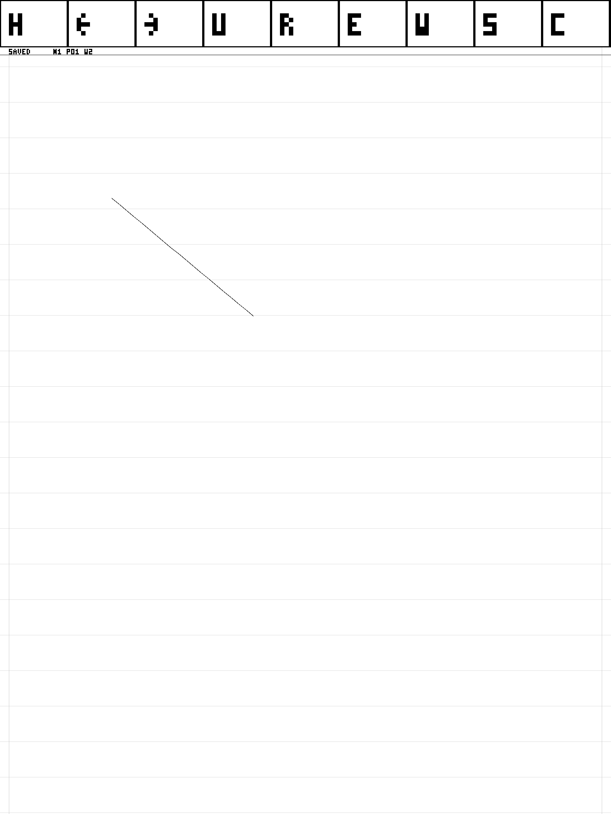

<!--
# Task 004 — durable native ink

LemmaSim now runs an offline notebook drawn and maintained by the compiled Lean RV64 guest. Pointer or recorded raw pen input enters the modeled FIFO and PLIC, becomes integer ink, reaches the isolated record service, and recovers after a real cold restart. The host transports input, controller pixels and block bytes; notebook policy, rasterization, codecs and recovery execute in the guest.

The Task004 primary slice is **ready for review** at implementation `7236f7889fb9dcee29783ccf7113ddaaa45c45d9`, tree `373730cfe37997c36977d3b0ce1b4d1aca7bf33f`, branch `task/004-lemmasim-durable-ink`. [PR #5](https://github.com/srkftw/lemma/pull/5) remains draft against main. Full clean acceptance, nine required CI jobs and independent outside-build archive verification passed. A later report-only commit has its own publication/CI identity; it does not change the tested implementation.



Actual guest controller output; automated GTK capture, manual interaction NOT_RUN.

Prepare once, then launch:

```sh
./scripts/lemmasim build
./scripts/lemmasim init --disk build/lemmasim/my-notebook.raw --size-mib 256
./scripts/lemmasim run --disk build/lemmasim/my-notebook.raw --mode student
./scripts/lemmasim run --disk build/lemmasim/my-notebook.raw --mode developer --record build/lemmasim/writing-session
./scripts/lemmasim replay --session build/lemmasim/writing-session --disk-copy build/lemmasim/replayed.raw
./scripts/lemmasim copy --disk build/lemmasim/my-notebook.raw --to /path/to/backup.raw
```

The nine guest tools switch notebooks, navigate/add pages, undo/redo, erase the latest visible whole stroke, select width, Save and Compact. Completed ink autosaves; SAVED, PENDING, FAILED and READ ONLY are guest-drawn. Save drains notebook publications and validates a short durable Inspect 8 response; it does not copy the live set. Explicit Compact uses owner-bound Begin 12/Status 13 receipts and remains Pending until its replacement root's final flush. Compact proactively before append space fills; after Full, restart to acknowledged writing before Compact. Original ink and finite object limits remain. Failed mounts never format a disk; `init --force` explicitly requests destruction. Default durability assumes the host filesystem/device honor fsync; Laboratory power cuts discard modeled volatile writes.

| Observation | Exact candidate result |
| --- | --- |
| O0/O2 strict artifact audit and selected capacity/stack | PASS |
| Live raw ink and exact cold document/pixels | PASS O0/O2 |
| Two notebooks, three pages, erase, undo/redo, recovery | PASS |
| Capability rejection and client death during writable DMA | PASS; pinned ownership and other notebook preserved |
| Same binary at 1650×2200 and 1404×1872 | PASS |
| Overflow, disconnect and contact watchdog with cold recovery | PASS |
| Scheduled/native replay and Busy reset | PASS; 13/13 replay observations |
| Append/checkpoint cuts, torn writes and failed flushes | PASS; 15 fault/cold cases |
| Publication barrier and pen-loss source negatives | PASS; real behavioral rejection |
| Fresh 16-page/100,000-sample workflow, memory and cold navigation | PASS |
| Ordinary CLI, automated GTK/native and Developer controls | PASS; all processes reaped |
| Required CI and independently verified offline retention | PASS |

The fresh workload retained 100,000 unique raw samples after 100,035 ingress events and reached Saved 848 through guest Save 7/Compact 8. Cold recovery preserved exact document/pixels and completed all 16 page redraws. Its 62 readonly allocator samples, including final-before-reap, observed minimum 7556 free frames and maximum 2,605,056 allocated bytes in the 32 MiB pool. Selected normal append/raster closures do not load full history per sample; page loading and Compact are separately bounded. Sampling is not a whole-run peak or whole-program memory proof.

Limits are two fixed notebook namespaces in one document-service authority domain, 64 pages each, 512 immutable chunks plus 512 edits per page, 384 raw 72-byte samples per chunk, 1024 latest object keys and 32 KiB transactions. Two pending 384-sample buffers apply visible backpressure. Long strokes use continuations; acknowledged records survive exhaustion. Compact does not remove immutable key/page/edit limits.

M-firmware→S-kernel→U-notebook/store isolation remains; only the store receives raw-block authority. DMA/bounce pages remain pinned until completion or reset quiescence. User 16 KiB stacks have unmapped guards. Kernel 16 KiB stacks use canaries with S interrupt nesting disabled; canaries are not hardware guards. O0 trap/Notebook/Store bounds are 9328/16352, 10560/16384, 4304/16384 bytes; O2 totals 1984, 1408, 736. Trap bounds include 288-byte entry. Minimum selected headroom is 35.5%; these bounds are not whole-program proofs. The trusted Supervisor writable alias remains explicit.

Mouse pressure is synthetic; recorded input exercises varying pressure. Physical tablet input and manual visible interaction are NOT_RUN. A stationary held mouse without samples reaches the one-synthetic-second watchdog, cancelling its unsaved tail until lift/new contact. Automated GTK used pinned Xvfb 21.1.24 with retained executable/recipe provenance. GTK/headless pixels match; documents preserve 63 differing original timestamp bytes, each capture passes its own exact replay/cold comparison. Developer pause/resume/inspect passed; mutating controls invalidate an unmodified replay claim.

Large recovery and Compact take minutes. Focused current-guest recovery of the old 100k disk observed Save 0.170s with zero I/O, Compact 174.866 guest seconds, then exact cold recovery 86.171s. Small O0 Save/Compact/cold also passed. The fresh cold-navigation process lasted 974.697s including planned 60-second navigation gaps; that duration is not a mount-time measurement.

Full result SHA `6ba8e737be7a7240b45f8120b99215a750d8272c7e45612ceb2cf62f29dc9aaa`; [CI 38096937753](https://github.com/srkftw/lemma/actions/runs/38096937753) passed nine jobs on an independently verified equal synthetic tree. Its nine ZIPs 185,046,999 bytes and original reports 2,286,226 bytes are archived. Actions expire after 14 days; permanent remote retention is not configured.

The verified outside archive is `/home/sreekumaar/Downloads/lemma-task004-7236f78-evidence2.tar.gz`, 195,965,460 bytes, SHA `808cb3e7c286a3838e5561bdf960bc33e17405ebce3bf214d5ff52b7fdd08147`. Independent verification checked 1102 members, both inventories/aliases and the exact clean implementation Git bundle. It retains guest images, initial medium, raw input, device/storage traces, committed documents, controller screenshot, memory observations, actual CI and selector/verifier provenance. The [result](004-lemmasim-durable-ink-result.json) and [manifest](004-lemmasim-durable-ink-manifest.json) record exact commands and hashes. Reusable export:

```sh
./scripts/lemmasim archive --acceptance build/lemmasim/task004-7236f78-full1-headless --to /path/to/task004-implementation-evidence.tar.gz
```

Earlier checkpoint timeout 93, Save-scalability interruption and strict table rejection remain FAIL under their original identities. First archive verification rejected duplicate selection rows; its failed export is retained. [Task003 evidence](003-kernel-isolated-services.md) preserves inherited results. This bounded notebook does not complete the managed runtime, general filesystem, all G4, mathematics/tutor, browser, snapshots or physical equivalence.

-->
